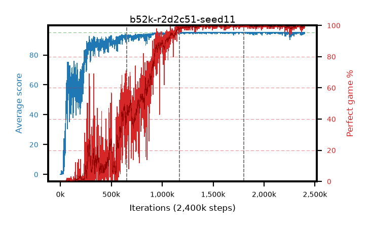

# b52k-r2d2c51-seed11

step **2,400,000** · 2400 evals · trailing **94.65** · peak **94.99** @1,571,000 · sef **61.4** · best30 **99.8** @1,571,000

## Config

| | |
|---|---|
| adam_epsilon | 0.001 |
| algo | r2d2 |
| apex_alpha | 7.0 |
| batch_size | 64 |
| collect_envs | 32 |
| discount | 0.997 |
| dist_atoms | 51 |
| dist_v_max | 110.0 |
| dist_v_min | -10.0 |
| epsilon_anneal_steps | 0 |
| epsilon_schedule | apex |
| eval_interval | 1000 |
| eval_queue | True |
| eval_queue_depth | 16 |
| eval_workers | 8 |
| fc_layers | (320,) |
| gradient_clipping | 40.0 |
| graph_eval_episodes | 100 |
| init_from | None |
| initial_collect_steps | 20000 |
| initial_epsilon | 0.4 |
| learning_rate | 0.0001 |
| max_steps | 2400000 |
| min_checkpoint_score | 40.0 |
| min_epsilon | 0.0 |
| n_step_update | 5 |
| priority_exponent | 0.9 |
| r2d2_burn_in | 40 |
| r2d2_head | c51 |
| r2d2_hidden | 512 |
| r2d2_is_beta | 0.6 |
| r2d2_prev_input | True |
| r2d2_priority_eta | 0.9 |
| r2d2_recurrent | lstm |
| r2d2_rescale | False |
| r2d2_rescale_eps | 0.001 |
| r2d2_seq_length | 120 |
| r2d2_stream_width | 512 |
| r2d2_stride | 40 |
| r2d2_windows | 30000 |
| replay_ratio | 0.003125 |
| seed | 11 |
| target_update_period | 2500 |
| torch_threads | 1 |

## Resumes

Resumed at 650,000, 1,170,000, 1,800,000

## Evals

| step | avg score | trailing avg | min score | max score | avg reward | perfect % | epsilon |
|---|---|---|---|---|---|---|---|
| 1000 | 0.05 | 0.05 | 0.0 | 1.0 | -4.953 | 0.0 | 0.4 |
| 2000 | 0.06 | 0.06 | 0.0 | 1.0 | -4.944 | 0.0 | 0.4 |
| 3000 | 0.05 | 0.05 | 0.0 | 1.0 | -4.952 | 0.0 | 0.4 |
| ... | ... | ... | ... | ... | ... | ... | ... |
| 2389000 | 95.0 | 94.59 | 95.0 | 95.0 | 193.701 | 100.0 | 0.4 |
| 2390000 | 94.31 | 94.56 | 28.0 | 95.0 | 190.973 | 98.0 | 0.4 |
| 2391000 | 94.42 | 94.54 | 37.0 | 95.0 | 192.093 | 99.0 | 0.4 |
| 2392000 | 95.0 | 94.6 | 95.0 | 95.0 | 193.729 | 100.0 | 0.4 |
| 2393000 | 95.0 | 94.6 | 95.0 | 95.0 | 193.715 | 100.0 | 0.4 |
| 2394000 | 94.97 | 94.6 | 92.0 | 95.0 | 192.674 | 99.0 | 0.4 |
| 2395000 | 94.97 | 94.6 | 92.0 | 95.0 | 192.647 | 99.0 | 0.4 |
| 2396000 | 94.18 | 94.59 | 14.0 | 95.0 | 190.808 | 98.0 | 0.4 |
| 2397000 | 95.0 | 94.59 | 95.0 | 95.0 | 193.72 | 100.0 | 0.4 |
| 2398000 | 95.0 | 94.59 | 95.0 | 95.0 | 193.713 | 100.0 | 0.4 |
| 2399000 | 95.0 | 94.59 | 95.0 | 95.0 | 193.716 | 100.0 | 0.4 |
| 2400000 | 95.0 | 94.65 | 95.0 | 95.0 | 193.723 | 100.0 | 0.4 |
