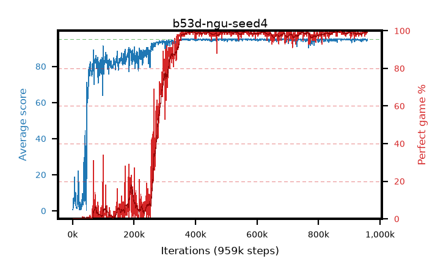

# b53d-ngu-seed4

step **959,000** · 959 evals · trailing **94.69** · peak **94.92** @572,000 · sef **68.5** · best30 **99.4** @872,000

## Config

| | |
|---|---|
| adam_epsilon | 0.0001 |
| algo | ngu |
| apex_alpha | 8.0 |
| batch_size | 64 |
| collect_envs | 32 |
| discount | 0.997 |
| epsilon_anneal_steps | 0 |
| epsilon_schedule | apex |
| eval_interval | 1000 |
| eval_queue | True |
| eval_queue_depth | 16 |
| eval_workers | 8 |
| fc_layers | (320,) |
| gradient_clipping | 40.0 |
| graph_eval_episodes | 100 |
| init_from | None |
| initial_collect_steps | 20000 |
| initial_epsilon | 0.4 |
| learning_rate | 0.0001 |
| max_steps | 1300000 |
| min_checkpoint_score | 40.0 |
| min_epsilon | 0.0 |
| n_step_update | 5 |
| ngu_assign | fixed |
| ngu_beta_max | 0.3 |
| ngu_cluster_distance | 0.008 |
| ngu_embed_dim | 32 |
| ngu_embed_hidden | 128 |
| ngu_embed_l2 | 1e-05 |
| ngu_embed_lr | 0.0005 |
| ngu_embed_steps | 5 |
| ngu_epsilon_permute | True |
| ngu_gamma_min | 0.99 |
| ngu_input | board |
| ngu_kernel_epsilon | 0.0001 |
| ngu_knn_k | 10 |
| ngu_lifelong_max | 5.0 |
| ngu_max_similarity | 8.0 |
| ngu_memory | 30000 |
| ngu_min_windows | 6250 |
| ngu_mixtures | 32 |
| ngu_pseudo_count | 0.001 |
| ngu_retrace_lambda | 0.95 |
| ngu_rnd_hidden | 128 |
| ngu_rnd_out | 128 |
| ngu_target_epsilon | 0.01 |
| priority_exponent | 0.9 |
| r2d2_burn_in | 40 |
| r2d2_hidden | 512 |
| r2d2_is_beta | 0.0 |
| r2d2_prev_input | True |
| r2d2_priority_eta | 1.0 |
| r2d2_recurrent | lstm |
| r2d2_rescale | True |
| r2d2_rescale_eps | 0.001 |
| r2d2_seq_length | 120 |
| r2d2_stream_width | 512 |
| r2d2_stride | 40 |
| r2d2_windows | 30000 |
| replay_ratio | 0.003125 |
| seed | 4 |
| target_update_period | 1500 |
| torch_threads | 1 |

## Evals

| step | avg score | trailing avg | min score | max score | avg reward | perfect % | epsilon |
|---|---|---|---|---|---|---|---|
| 1000 | 0.54 | 0.54 | 0.0 | 3.0 | -4.486 | 0.0 | 0.4 |
| 2000 | 2.39 | 1.47 | 0.0 | 8.0 | 1.286 | 0.0 | 0.4 |
| 3000 | 6.99 | 3.31 | 0.0 | 25.0 | 5.34 | 0.0 | 0.4 |
| ... | ... | ... | ... | ... | ... | ... | ... |
| 948000 | 95.0 | 94.67 | 95.0 | 95.0 | 193.702 | 100.0 | 0.4 |
| 949000 | 94.91 | 94.7 | 86.0 | 95.0 | 192.554 | 99.0 | 0.4 |
| 950000 | 94.82 | 94.7 | 85.0 | 95.0 | 190.433 | 97.0 | 0.4 |
| 951000 | 94.97 | 94.7 | 92.0 | 95.0 | 192.669 | 99.0 | 0.4 |
| 952000 | 95.0 | 94.7 | 95.0 | 95.0 | 193.709 | 100.0 | 0.4 |
| 953000 | 95.0 | 94.72 | 95.0 | 95.0 | 193.701 | 100.0 | 0.4 |
| 954000 | 94.93 | 94.72 | 88.0 | 95.0 | 192.578 | 99.0 | 0.4 |
| 955000 | 94.93 | 94.72 | 91.0 | 95.0 | 191.595 | 98.0 | 0.4 |
| 956000 | 94.06 | 94.69 | 1.0 | 95.0 | 191.756 | 99.0 | 0.4 |
| 957000 | 94.95 | 94.69 | 90.0 | 95.0 | 192.604 | 99.0 | 0.4 |
| 958000 | 94.42 | 94.67 | 37.0 | 95.0 | 192.076 | 99.0 | 0.4 |
| 959000 | 95.0 | 94.69 | 95.0 | 95.0 | 193.682 | 100.0 | 0.4 |
