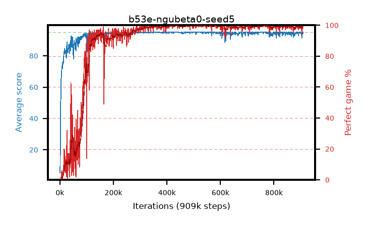

# b53e-ngubeta0-seed5

step **909,000** · 909 evals · trailing **94.47** · peak **94.95** @437,000 · sef **88.9** · best30 **99.8** @530,000

## Config

| | |
|---|---|
| adam_epsilon | 0.0001 |
| algo | ngu |
| apex_alpha | 8.0 |
| batch_size | 64 |
| collect_envs | 32 |
| discount | 0.997 |
| epsilon_anneal_steps | 0 |
| epsilon_schedule | apex |
| eval_interval | 1000 |
| eval_queue | True |
| eval_queue_depth | 16 |
| eval_workers | 8 |
| fc_layers | (320,) |
| gradient_clipping | 40.0 |
| graph_eval_episodes | 100 |
| init_from | None |
| initial_collect_steps | 20000 |
| initial_epsilon | 0.4 |
| learning_rate | 0.0001 |
| max_steps | 1300000 |
| min_checkpoint_score | 40.0 |
| min_epsilon | 0.0 |
| n_step_update | 5 |
| ngu_assign | fixed |
| ngu_beta_max | 0.0 |
| ngu_cluster_distance | 0.008 |
| ngu_embed_dim | 32 |
| ngu_embed_hidden | 128 |
| ngu_embed_l2 | 1e-05 |
| ngu_embed_lr | 0.0005 |
| ngu_embed_steps | 5 |
| ngu_epsilon_permute | True |
| ngu_gamma_min | 0.99 |
| ngu_input | board |
| ngu_kernel_epsilon | 0.0001 |
| ngu_knn_k | 10 |
| ngu_lifelong_max | 5.0 |
| ngu_max_similarity | 8.0 |
| ngu_memory | 30000 |
| ngu_min_windows | 6250 |
| ngu_mixtures | 32 |
| ngu_pseudo_count | 0.001 |
| ngu_retrace_lambda | 0.95 |
| ngu_rnd_hidden | 128 |
| ngu_rnd_out | 128 |
| ngu_target_epsilon | 0.01 |
| priority_exponent | 0.9 |
| r2d2_burn_in | 40 |
| r2d2_hidden | 512 |
| r2d2_is_beta | 0.0 |
| r2d2_prev_input | True |
| r2d2_priority_eta | 1.0 |
| r2d2_recurrent | lstm |
| r2d2_rescale | True |
| r2d2_rescale_eps | 0.001 |
| r2d2_seq_length | 120 |
| r2d2_stream_width | 512 |
| r2d2_stride | 40 |
| r2d2_windows | 30000 |
| replay_ratio | 0.003125 |
| seed | 5 |
| target_update_period | 1500 |
| torch_threads | 1 |

## Evals

| step | avg score | trailing avg | min score | max score | avg reward | perfect % | epsilon |
|---|---|---|---|---|---|---|---|
| 1000 | 5.31 | 5.31 | 0.0 | 13.0 | 2.019 | 0.0 | 0.4 |
| 2000 | 29.39 | 17.35 | 3.0 | 54.0 | 24.459 | 0.0 | 0.4 |
| 3000 | 50.81 | 28.5 | 16.0 | 85.0 | 45.457 | 0.0 | 0.4 |
| ... | ... | ... | ... | ... | ... | ... | ... |
| 898000 | 94.87 | 94.38 | 88.0 | 95.0 | 191.572 | 98.0 | 0.4 |
| 899000 | 95.0 | 94.41 | 95.0 | 95.0 | 193.78 | 100.0 | 0.4 |
| 900000 | 94.29 | 94.41 | 26.0 | 95.0 | 190.992 | 98.0 | 0.4 |
| 901000 | 94.47 | 94.4 | 42.0 | 95.0 | 192.208 | 99.0 | 0.4 |
| 902000 | 94.27 | 94.47 | 22.0 | 95.0 | 192.008 | 99.0 | 0.4 |
| 903000 | 94.35 | 94.48 | 30.0 | 95.0 | 192.078 | 99.0 | 0.4 |
| 904000 | 91.37 | 94.36 | 20.0 | 95.0 | 183.959 | 94.0 | 0.4 |
| 905000 | 93.01 | 94.32 | 26.0 | 95.0 | 188.668 | 97.0 | 0.4 |
| 906000 | 94.23 | 94.34 | 21.0 | 95.0 | 190.911 | 98.0 | 0.4 |
| 907000 | 95.0 | 94.41 | 95.0 | 95.0 | 193.784 | 100.0 | 0.4 |
| 908000 | 94.21 | 94.45 | 16.0 | 95.0 | 191.938 | 99.0 | 0.4 |
| 909000 | 95.0 | 94.47 | 95.0 | 95.0 | 193.781 | 100.0 | 0.4 |
