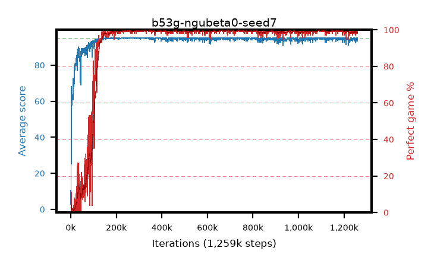

# b53g-ngubeta0-seed7

step **1,259,000** · 1259 evals · trailing **94.25** · peak **94.97** @274,000 · sef **91.2** · best30 **99.8** @1,111,000

## Config

| | |
|---|---|
| adam_epsilon | 0.0001 |
| algo | ngu |
| apex_alpha | 8.0 |
| batch_size | 64 |
| collect_envs | 32 |
| discount | 0.997 |
| epsilon_anneal_steps | 0 |
| epsilon_schedule | apex |
| eval_interval | 1000 |
| eval_queue | True |
| eval_queue_depth | 16 |
| eval_workers | 8 |
| fc_layers | (320,) |
| gradient_clipping | 40.0 |
| graph_eval_episodes | 100 |
| init_from | None |
| initial_collect_steps | 20000 |
| initial_epsilon | 0.4 |
| learning_rate | 0.0001 |
| max_steps | 1300000 |
| min_checkpoint_score | 40.0 |
| min_epsilon | 0.0 |
| n_step_update | 5 |
| ngu_assign | fixed |
| ngu_beta_max | 0.0 |
| ngu_cluster_distance | 0.008 |
| ngu_embed_dim | 32 |
| ngu_embed_hidden | 128 |
| ngu_embed_l2 | 1e-05 |
| ngu_embed_lr | 0.0005 |
| ngu_embed_steps | 5 |
| ngu_epsilon_permute | True |
| ngu_gamma_min | 0.99 |
| ngu_input | board |
| ngu_kernel_epsilon | 0.0001 |
| ngu_knn_k | 10 |
| ngu_lifelong_max | 5.0 |
| ngu_max_similarity | 8.0 |
| ngu_memory | 30000 |
| ngu_min_windows | 6250 |
| ngu_mixtures | 32 |
| ngu_pseudo_count | 0.001 |
| ngu_retrace_lambda | 0.95 |
| ngu_rnd_hidden | 128 |
| ngu_rnd_out | 128 |
| ngu_target_epsilon | 0.01 |
| priority_exponent | 0.9 |
| r2d2_burn_in | 40 |
| r2d2_hidden | 512 |
| r2d2_is_beta | 0.0 |
| r2d2_prev_input | True |
| r2d2_priority_eta | 1.0 |
| r2d2_recurrent | lstm |
| r2d2_rescale | True |
| r2d2_rescale_eps | 0.001 |
| r2d2_seq_length | 120 |
| r2d2_stream_width | 512 |
| r2d2_stride | 40 |
| r2d2_windows | 30000 |
| replay_ratio | 0.003125 |
| seed | 7 |
| target_update_period | 1500 |
| torch_threads | 1 |

## Evals

| step | avg score | trailing avg | min score | max score | avg reward | perfect % | epsilon |
|---|---|---|---|---|---|---|---|
| 1000 | 2.88 | 2.88 | 0.0 | 9.0 | 0.146 | 0.0 | 0.4 |
| 2000 | 37.8 | 20.34 | 6.0 | 63.0 | 32.628 | 0.0 | 0.4 |
| 3000 | 67.99 | 36.22 | 23.0 | 95.0 | 74.006 | 11.0 | 0.4 |
| ... | ... | ... | ... | ... | ... | ... | ... |
| 1248000 | 95.0 | 94.2 | 95.0 | 95.0 | 193.794 | 100.0 | 0.4 |
| 1249000 | 92.67 | 94.12 | 15.0 | 95.0 | 188.353 | 97.0 | 0.4 |
| 1250000 | 92.56 | 94.17 | 6.0 | 95.0 | 188.239 | 97.0 | 0.4 |
| 1251000 | 94.24 | 94.17 | 19.0 | 95.0 | 192.0 | 99.0 | 0.4 |
| 1252000 | 94.37 | 94.2 | 32.0 | 95.0 | 192.124 | 99.0 | 0.4 |
| 1253000 | 94.97 | 94.22 | 92.0 | 95.0 | 192.721 | 99.0 | 0.4 |
| 1254000 | 94.26 | 94.28 | 21.0 | 95.0 | 192.02 | 99.0 | 0.4 |
| 1255000 | 93.46 | 94.25 | 16.0 | 95.0 | 190.168 | 98.0 | 0.4 |
| 1256000 | 94.29 | 94.25 | 24.0 | 95.0 | 192.04 | 99.0 | 0.4 |
| 1257000 | 93.48 | 94.23 | 12.0 | 95.0 | 190.189 | 98.0 | 0.4 |
| 1258000 | 93.65 | 94.23 | 27.0 | 95.0 | 190.365 | 98.0 | 0.4 |
| 1259000 | 95.0 | 94.25 | 95.0 | 95.0 | 193.786 | 100.0 | 0.4 |
