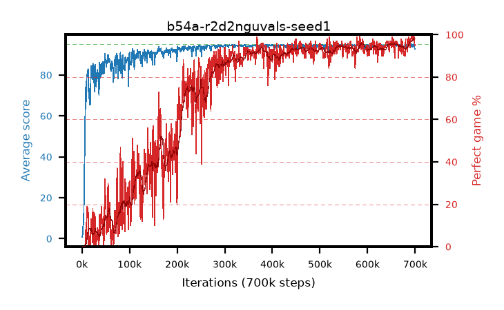

# b54a-r2d2nguvals-seed1

step **700,000** · 700 evals · trailing **94.28** · peak **94.59** @655,000 · sef **63.3** · best30 **96.0** @699,000

## Config

| | |
|---|---|
| adam_epsilon | 0.0001 |
| algo | r2d2 |
| apex_alpha | 8.0 |
| batch_size | 64 |
| collect_envs | 32 |
| discount | 0.997 |
| dist_atoms | 51 |
| dist_v_max | 110.0 |
| dist_v_min | -10.0 |
| epsilon_anneal_steps | 0 |
| epsilon_schedule | apex |
| eval_interval | 1000 |
| eval_queue | True |
| eval_queue_depth | 16 |
| eval_workers | 8 |
| fc_layers | (320,) |
| gradient_clipping | 40.0 |
| graph_eval_episodes | 100 |
| init_from | None |
| initial_collect_steps | 20000 |
| initial_epsilon | 0.4 |
| learning_rate | 0.0001 |
| max_steps | 700000 |
| min_checkpoint_score | 40.0 |
| min_epsilon | 0.0 |
| n_step_update | 5 |
| priority_exponent | 0.9 |
| r2d2_burn_in | 40 |
| r2d2_head | scalar |
| r2d2_hidden | 512 |
| r2d2_is_beta | 0.0 |
| r2d2_prev_input | True |
| r2d2_priority_eta | 1.0 |
| r2d2_recurrent | lstm |
| r2d2_rescale | True |
| r2d2_rescale_eps | 0.001 |
| r2d2_seq_length | 120 |
| r2d2_stream_width | 512 |
| r2d2_stride | 40 |
| r2d2_windows | 30000 |
| replay_ratio | 0.003125 |
| seed | 1 |
| target_update_period | 1500 |
| torch_threads | 1 |

## Evals

| step | avg score | trailing avg | min score | max score | avg reward | perfect % | epsilon |
|---|---|---|---|---|---|---|---|
| 1000 | 0.78 | 0.78 | 0.0 | 3.0 | 0.226 | 0.0 | 0.4 |
| 2000 | 4.26 | 2.52 | 1.0 | 7.0 | -0.677 | 0.0 | 0.4 |
| 3000 | 7.14 | 4.06 | 1.0 | 16.0 | 4.322 | 0.0 | 0.4 |
| ... | ... | ... | ... | ... | ... | ... | ... |
| 689000 | 94.33 | 94.31 | 60.0 | 95.0 | 186.862 | 94.0 | 0.4 |
| 690000 | 94.76 | 94.3 | 86.0 | 95.0 | 190.339 | 97.0 | 0.4 |
| 691000 | 94.14 | 94.3 | 39.0 | 95.0 | 190.766 | 98.0 | 0.4 |
| 692000 | 94.97 | 94.31 | 92.0 | 95.0 | 192.629 | 99.0 | 0.4 |
| 693000 | 94.98 | 94.33 | 93.0 | 95.0 | 192.643 | 99.0 | 0.4 |
| 694000 | 93.74 | 94.31 | 2.0 | 95.0 | 190.366 | 98.0 | 0.4 |
| 695000 | 94.75 | 94.35 | 73.0 | 95.0 | 191.369 | 98.0 | 0.4 |
| 696000 | 95.0 | 94.37 | 95.0 | 95.0 | 193.658 | 100.0 | 0.4 |
| 697000 | 94.04 | 94.34 | 1.0 | 95.0 | 190.693 | 98.0 | 0.4 |
| 698000 | 94.96 | 94.39 | 91.0 | 95.0 | 192.592 | 99.0 | 0.4 |
| 699000 | 92.86 | 94.34 | 2.0 | 95.0 | 186.49 | 95.0 | 0.4 |
| 700000 | 92.7 | 94.28 | 1.0 | 95.0 | 186.379 | 95.0 | 0.4 |
