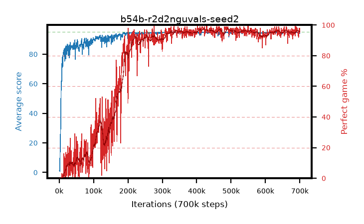

# b54b-r2d2nguvals-seed2

step **700,000** · 700 evals · trailing **94.58** · peak **94.74** @565,000 · sef **72.7** · best30 **97.1** @430,000

## Config

| | |
|---|---|
| adam_epsilon | 0.0001 |
| algo | r2d2 |
| apex_alpha | 8.0 |
| batch_size | 64 |
| collect_envs | 32 |
| discount | 0.997 |
| dist_atoms | 51 |
| dist_v_max | 110.0 |
| dist_v_min | -10.0 |
| epsilon_anneal_steps | 0 |
| epsilon_schedule | apex |
| eval_interval | 1000 |
| eval_queue | True |
| eval_queue_depth | 16 |
| eval_workers | 8 |
| fc_layers | (320,) |
| gradient_clipping | 40.0 |
| graph_eval_episodes | 100 |
| init_from | None |
| initial_collect_steps | 20000 |
| initial_epsilon | 0.4 |
| learning_rate | 0.0001 |
| max_steps | 700000 |
| min_checkpoint_score | 40.0 |
| min_epsilon | 0.0 |
| n_step_update | 5 |
| priority_exponent | 0.9 |
| r2d2_burn_in | 40 |
| r2d2_head | scalar |
| r2d2_hidden | 512 |
| r2d2_is_beta | 0.0 |
| r2d2_prev_input | True |
| r2d2_priority_eta | 1.0 |
| r2d2_recurrent | lstm |
| r2d2_rescale | True |
| r2d2_rescale_eps | 0.001 |
| r2d2_seq_length | 120 |
| r2d2_stream_width | 512 |
| r2d2_stride | 40 |
| r2d2_windows | 30000 |
| replay_ratio | 0.003125 |
| seed | 2 |
| target_update_period | 1500 |
| torch_threads | 1 |

## Evals

| step | avg score | trailing avg | min score | max score | avg reward | perfect % | epsilon |
|---|---|---|---|---|---|---|---|
| 1000 | 1.3 | 1.3 | 1.0 | 2.0 | -0.597 | 0.0 | 0.4 |
| 2000 | 0.78 | 1.04 | 0.0 | 4.0 | 0.002 | 0.0 | 0.4 |
| 3000 | 16.29 | 6.12 | 2.0 | 34.0 | 11.643 | 0.0 | 0.4 |
| ... | ... | ... | ... | ... | ... | ... | ... |
| 689000 | 94.83 | 94.43 | 88.0 | 95.0 | 190.406 | 97.0 | 0.4 |
| 690000 | 94.97 | 94.44 | 92.0 | 95.0 | 192.604 | 99.0 | 0.4 |
| 691000 | 94.79 | 94.43 | 82.0 | 95.0 | 189.395 | 96.0 | 0.4 |
| 692000 | 94.88 | 94.43 | 88.0 | 95.0 | 191.532 | 98.0 | 0.4 |
| 693000 | 94.53 | 94.45 | 76.0 | 95.0 | 188.12 | 95.0 | 0.4 |
| 694000 | 94.7 | 94.45 | 78.0 | 95.0 | 188.196 | 95.0 | 0.4 |
| 695000 | 94.79 | 94.5 | 88.0 | 95.0 | 188.252 | 95.0 | 0.4 |
| 696000 | 94.43 | 94.51 | 70.0 | 95.0 | 185.073 | 92.0 | 0.4 |
| 697000 | 94.86 | 94.52 | 90.0 | 95.0 | 189.455 | 96.0 | 0.4 |
| 698000 | 94.68 | 94.55 | 68.0 | 95.0 | 191.338 | 98.0 | 0.4 |
| 699000 | 93.99 | 94.55 | 10.0 | 95.0 | 187.552 | 95.0 | 0.4 |
| 700000 | 94.9 | 94.58 | 88.0 | 95.0 | 191.527 | 98.0 | 0.4 |
