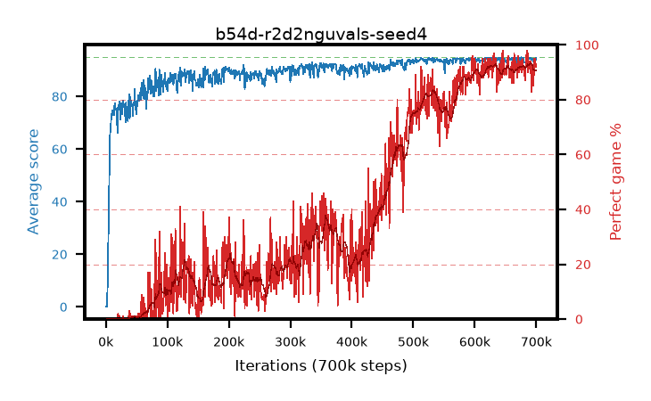

# b54d-r2d2nguvals-seed4

step **700,000** · 700 evals · trailing **94.07** · peak **94.13** @641,000 · sef **23.4** · best30 **92.4** @693,000

## Config

| | |
|---|---|
| adam_epsilon | 0.0001 |
| algo | r2d2 |
| apex_alpha | 8.0 |
| batch_size | 64 |
| collect_envs | 32 |
| discount | 0.997 |
| dist_atoms | 51 |
| dist_v_max | 110.0 |
| dist_v_min | -10.0 |
| epsilon_anneal_steps | 0 |
| epsilon_schedule | apex |
| eval_interval | 1000 |
| eval_queue | True |
| eval_queue_depth | 16 |
| eval_workers | 8 |
| fc_layers | (320,) |
| gradient_clipping | 40.0 |
| graph_eval_episodes | 100 |
| init_from | None |
| initial_collect_steps | 20000 |
| initial_epsilon | 0.4 |
| learning_rate | 0.0001 |
| max_steps | 700000 |
| min_checkpoint_score | 40.0 |
| min_epsilon | 0.0 |
| n_step_update | 5 |
| priority_exponent | 0.9 |
| r2d2_burn_in | 40 |
| r2d2_head | scalar |
| r2d2_hidden | 512 |
| r2d2_is_beta | 0.0 |
| r2d2_prev_input | True |
| r2d2_priority_eta | 1.0 |
| r2d2_recurrent | lstm |
| r2d2_rescale | True |
| r2d2_rescale_eps | 0.001 |
| r2d2_seq_length | 120 |
| r2d2_stream_width | 512 |
| r2d2_stride | 40 |
| r2d2_windows | 30000 |
| replay_ratio | 0.003125 |
| seed | 4 |
| target_update_period | 1500 |
| torch_threads | 1 |

## Evals

| step | avg score | trailing avg | min score | max score | avg reward | perfect % | epsilon |
|---|---|---|---|---|---|---|---|
| 1000 | 0.08 | 0.08 | 0.0 | 2.0 | -0.693 | 0.0 | 0.4 |
| 2000 | 0.1 | 0.09 | 0.0 | 2.0 | -0.449 | 0.0 | 0.4 |
| 3000 | 8.88 | 3.02 | 0.0 | 26.0 | 6.359 | 0.0 | 0.4 |
| ... | ... | ... | ... | ... | ... | ... | ... |
| 689000 | 94.52 | 94.07 | 78.0 | 95.0 | 186.922 | 94.0 | 0.4 |
| 690000 | 94.34 | 94.06 | 70.0 | 95.0 | 185.777 | 93.0 | 0.4 |
| 691000 | 94.53 | 94.05 | 76.0 | 95.0 | 186.89 | 94.0 | 0.4 |
| 692000 | 93.95 | 94.09 | 74.0 | 95.0 | 174.978 | 83.0 | 0.4 |
| 693000 | 94.41 | 94.09 | 76.0 | 95.0 | 185.831 | 93.0 | 0.4 |
| 694000 | 94.09 | 94.07 | 74.0 | 95.0 | 179.285 | 87.0 | 0.4 |
| 695000 | 93.38 | 94.03 | 54.0 | 95.0 | 176.419 | 85.0 | 0.4 |
| 696000 | 94.06 | 94.05 | 24.0 | 95.0 | 187.455 | 95.0 | 0.4 |
| 697000 | 93.39 | 94.0 | 50.0 | 95.0 | 180.592 | 89.0 | 0.4 |
| 698000 | 94.18 | 94.1 | 25.0 | 95.0 | 187.575 | 95.0 | 0.4 |
| 699000 | 93.67 | 94.07 | 14.0 | 95.0 | 185.099 | 93.0 | 0.4 |
| 700000 | 94.67 | 94.07 | 84.0 | 95.0 | 184.985 | 92.0 | 0.4 |
