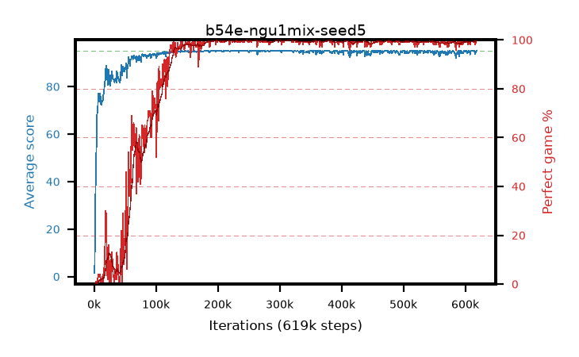

# b54e-ngu1mix-seed5

step **619,000** · 619 evals · trailing **94.62** · peak **94.98** @318,000 · sef **83.4** · best30 **99.8** @318,000

## Config

| | |
|---|---|
| adam_epsilon | 0.0001 |
| algo | ngu |
| apex_alpha | 8.0 |
| batch_size | 64 |
| collect_envs | 32 |
| discount | 0.997 |
| epsilon_anneal_steps | 0 |
| epsilon_schedule | apex |
| eval_interval | 1000 |
| eval_queue | True |
| eval_queue_depth | 16 |
| eval_workers | 8 |
| fc_layers | (320,) |
| gradient_clipping | 40.0 |
| graph_eval_episodes | 100 |
| init_from | None |
| initial_collect_steps | 20000 |
| initial_epsilon | 0.4 |
| learning_rate | 0.0001 |
| max_steps | 700000 |
| min_checkpoint_score | 40.0 |
| min_epsilon | 0.0 |
| n_step_update | 5 |
| ngu_assign | episode |
| ngu_beta_max | 0.0 |
| ngu_cluster_distance | 0.008 |
| ngu_embed_dim | 32 |
| ngu_embed_hidden | 128 |
| ngu_embed_l2 | 1e-05 |
| ngu_embed_lr | 0.0005 |
| ngu_embed_steps | 5 |
| ngu_epsilon_permute | True |
| ngu_gamma_min | 0.99 |
| ngu_input | board |
| ngu_kernel_epsilon | 0.0001 |
| ngu_knn_k | 10 |
| ngu_lifelong_max | 5.0 |
| ngu_max_similarity | 8.0 |
| ngu_memory | 30000 |
| ngu_min_windows | 6250 |
| ngu_mixtures | 1 |
| ngu_pseudo_count | 0.001 |
| ngu_retrace_lambda | 0.95 |
| ngu_rnd_hidden | 128 |
| ngu_rnd_out | 128 |
| ngu_target_epsilon | 0.01 |
| priority_exponent | 0.9 |
| r2d2_burn_in | 40 |
| r2d2_hidden | 512 |
| r2d2_is_beta | 0.0 |
| r2d2_prev_input | True |
| r2d2_priority_eta | 1.0 |
| r2d2_recurrent | lstm |
| r2d2_rescale | True |
| r2d2_rescale_eps | 0.001 |
| r2d2_seq_length | 120 |
| r2d2_stream_width | 512 |
| r2d2_stride | 40 |
| r2d2_windows | 30000 |
| replay_ratio | 0.003125 |
| seed | 5 |
| target_update_period | 1500 |
| torch_threads | 1 |

## Evals

| step | avg score | trailing avg | min score | max score | avg reward | perfect % | epsilon |
|---|---|---|---|---|---|---|---|
| 1000 | 1.52 | 1.52 | 0.0 | 6.0 | -0.306 | 0.0 | 0.4 |
| 2000 | 28.15 | 14.83 | 4.0 | 60.0 | 23.211 | 0.0 | 0.4 |
| 3000 | 44.73 | 24.8 | 13.0 | 95.0 | 40.619 | 1.0 | 0.4 |
| ... | ... | ... | ... | ... | ... | ... | ... |
| 608000 | 93.56 | 94.41 | 19.0 | 95.0 | 190.268 | 98.0 | 0.4 |
| 609000 | 95.0 | 94.41 | 95.0 | 95.0 | 193.786 | 100.0 | 0.4 |
| 610000 | 95.0 | 94.41 | 95.0 | 95.0 | 193.783 | 100.0 | 0.4 |
| 611000 | 95.0 | 94.41 | 95.0 | 95.0 | 193.781 | 100.0 | 0.4 |
| 612000 | 95.0 | 94.42 | 95.0 | 95.0 | 193.786 | 100.0 | 0.4 |
| 613000 | 95.0 | 94.45 | 95.0 | 95.0 | 193.786 | 100.0 | 0.4 |
| 614000 | 94.91 | 94.49 | 86.0 | 95.0 | 192.653 | 99.0 | 0.4 |
| 615000 | 95.0 | 94.59 | 95.0 | 95.0 | 193.787 | 100.0 | 0.4 |
| 616000 | 93.81 | 94.6 | 10.0 | 95.0 | 190.554 | 98.0 | 0.4 |
| 617000 | 94.26 | 94.6 | 21.0 | 95.0 | 192.002 | 99.0 | 0.4 |
| 618000 | 95.0 | 94.62 | 95.0 | 95.0 | 193.782 | 100.0 | 0.4 |
| 619000 | 95.0 | 94.62 | 95.0 | 95.0 | 193.781 | 100.0 | 0.4 |
